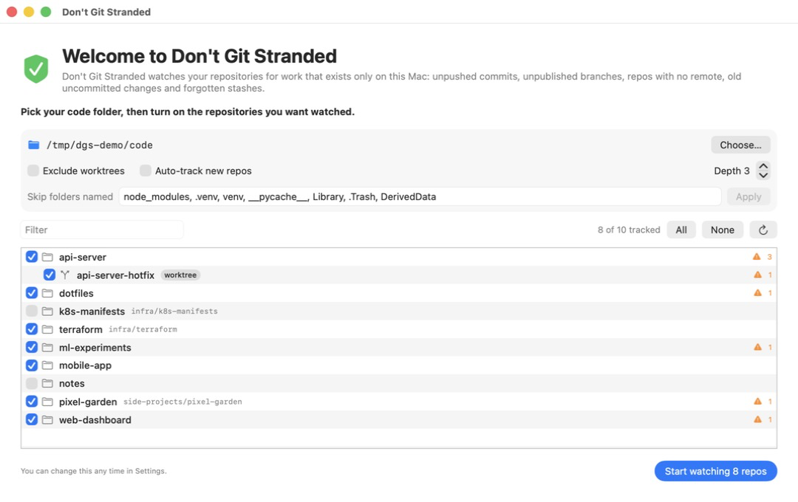
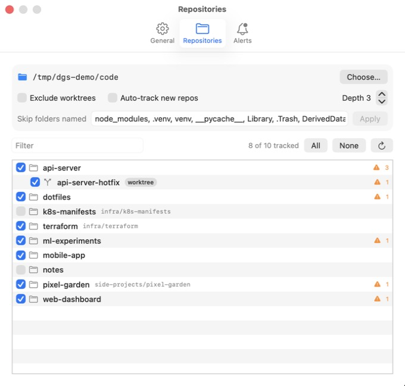
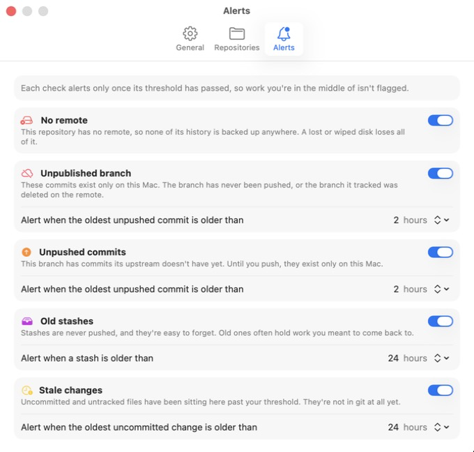
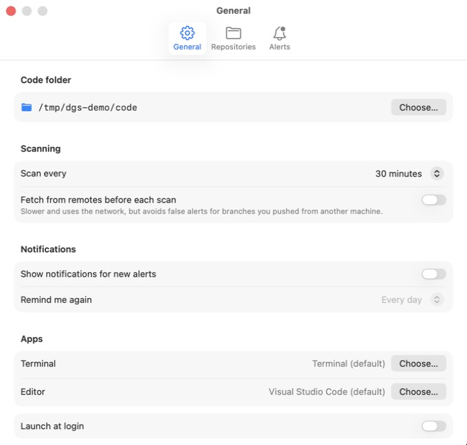

# Don't Git Stranded

A macOS menu bar app that finds git work that exists only on your Mac before a lost laptop, a wiped disk or a forgotten branch takes it with it.

It watches the repositories you choose and alerts you when something has been sitting unbacked-up for longer than you're comfortable with. Each alert comes with a fix you can apply in one click.



| Repositories | Alerts | General |
|---|---|---|
|  |  |  |

## What it flags

| Alert | When | One-click fix |
|---|---|---|
| **No remote** | The repo has commits but no remote at all | Add remote… (optionally push every branch) |
| **Unpublished branch** | A branch has commits that are on no remote: it was never pushed, or its upstream was deleted while it still had local-only commits | Publish (`git push -u`) |
| **Unpushed commits** | A branch is ahead of its upstream | Push |
| **Old stashes** | A stash is older than your threshold (stashes are never pushed) | Save as branch… / Drop… |
| **Stale changes** | Uncommitted or untracked files older than your threshold | Commit all… (optionally push) |

Every alert can also be opened in Terminal, your editor, Finder or the remote's web page, and snoozed (1 hour to 1 week) or muted.

Thresholds keep it quiet about work in progress: by default, unpushed commits alert after 2 hours, and stale changes and stashes after 1 day. A remote branch that was deleted after its work was merged is not flagged.

## Features

- **Menu bar icon** showing the number of open alerts, with the most urgent ones in the dropdown and Push/Publish on hover.
- **Main window** listing alerts by type or repository, with a detail pane: why it matters, the commits, files or stashes involved, and the actions.
- **Opt-in tracking**: choose a code folder, then tick the repositories to watch. You can optionally auto-track new ones.
- **Worktrees**: excluded by default. When included, a new worktree of a tracked repo is tracked automatically, and shared alerts aren't duplicated.
- **Notifications** for new alerts, with an optional reminder (every 4 hours, daily or weekly). Click one to open that alert.
- **Scheduling**: scans every 5 minutes to 12 hours and after waking from sleep. It can optionally `git fetch` first.
- **Launch at login.**

## Install

Requires macOS 15 or later and Xcode 16 or later (Swift 6). There is no prebuilt download yet, so build it from source:

```bash
git clone https://github.com/adamrudolph/dont-git-stranded.git
cd dont-git-stranded
scripts/build-app.sh --install
```

This builds `DontGitStranded.app` (universal, ad-hoc signed), copies it to `~/Applications` and launches it. On first launch, a setup screen asks for your code folder and the repos to watch. Settings live behind the gear icon in the menu bar dropdown.

To build without installing, run `scripts/build-app.sh`; the app is written to `build/`.

## Command-line version

`git-stranded` is a standalone Python 3 script (standard library only) that runs the same checks for terminals, cron jobs or CI. Put it on your `PATH` and git runs it as a subcommand:

```bash
git stranded                      # scan ~/code
git stranded --root ~/src --stale-hours 48 --fetch
git stranded --json               # machine-readable output
```

It exits 0 when everything is clean, 1 when there are issues, and 2 on bad usage. Settings are read from defaults, then `~/.config/git-stranded/config.json`, then the `GIT_STRANDED_ROOT`, `GIT_STRANDED_STALE_HOURS` and `GIT_STRANDED_MAX_DEPTH` environment variables, then flags, with later sources winning. Run `git stranded --help` for the full list.

The app and the CLI keep separate settings.

## How it works and what it touches

- **Scans are read-only.** It runs `git for-each-ref`, `log`, `status`, `stash list` and similar commands, with `GIT_OPTIONAL_LOCKS=0`, so it never takes locks your own git commands would wait on.
- **It never runs code from the repos it scans.** A repository's `.git/config` can set `core.fsmonitor` to an arbitrary command that `git status` would execute, so both the app and the CLI force `core.fsmonitor=false`. The test suite includes a check for this.
- **Actions change your repos only when you click them**: push, publish, commit, add remote, create a branch from a stash, drop a stash. Dropping a stash asks for confirmation and first checks that the stash still is the one you were shown. Remote names, URLs and branch names are validated before they're passed to git.
- **Network access** happens only on push or publish, or when you turn on "Fetch before scan". These use your normal git configuration and credentials. Git never prompts from the app: if a credential or SSH passphrase is needed, the action fails and shows git's message.
- **Your settings stay local**, in the app's macOS preferences. There is no telemetry.

Without "Fetch before scan", ahead-of-upstream information is only as fresh as your last fetch, so a branch you pushed from another machine can look unpushed until then. When the only pending changes are deletions, git has no file age to go on, so the stale age is estimated from the last git operation.

## Development

```bash
swift build                       # debug build
swift test                        # scanner + CLI tests against throwaway repos
.build/debug/DontGitStranded --scan ~/code   # print alerts without the UI
```

| Path | What's there |
|---|---|
| `Sources/DontGitStranded/Scanner.swift` | Repo discovery and the five checks |
| `Sources/DontGitStranded/Git.swift` | Runs git (no shell, hardened, with timeouts) |
| `Sources/DontGitStranded/AppState*.swift` | State, scheduling, notifications and the actions |
| `Sources/DontGitStranded/*View.swift` | SwiftUI: menu bar, main window, settings |
| `git-stranded` | The standalone CLI |

## License

[MIT](LICENSE)
